# Hi there, I'm Anshu Raj 👋

### 💻 Computer Science Student | Full Stack Web Developer

I am a Computer Science student passionate about web development, programming, and building real-world applications.

---

## 🚀 What I'm Doing

- 💻 Learning Full Stack Web Development.
- 🌐 Building interactive and responsive websites.
- 🧠 Improving my problem-solving skills.
- 📚 Exploring backend development and databases.
- 🚀 Working on personal and college projects.
---

## 🛠️ Tech Stack & Skills

### Programming Languages

### Frontend Development

### Backend Development

### Database

### Tools

---

## 📌 Featured Projects

- 🏨 Hotel Management System
- 🎮 Rock Paper Scissors Game
- 🧮 Simple Calculator
- 🤖 ChatBot

---

## 📊 GitHub Statistics

---

## 📫 Connect With Me

- GitHub: https://github.com/Anshu-coder-art
- LinkedIn: https://www.linkedin.com/in/anshu-raj-coder/
- Email: contact.anshu.in@gmail.com

